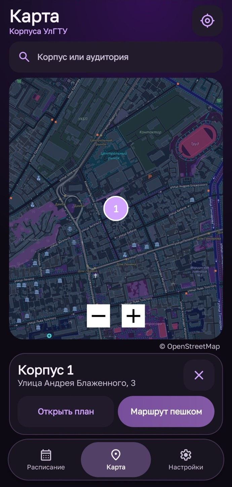
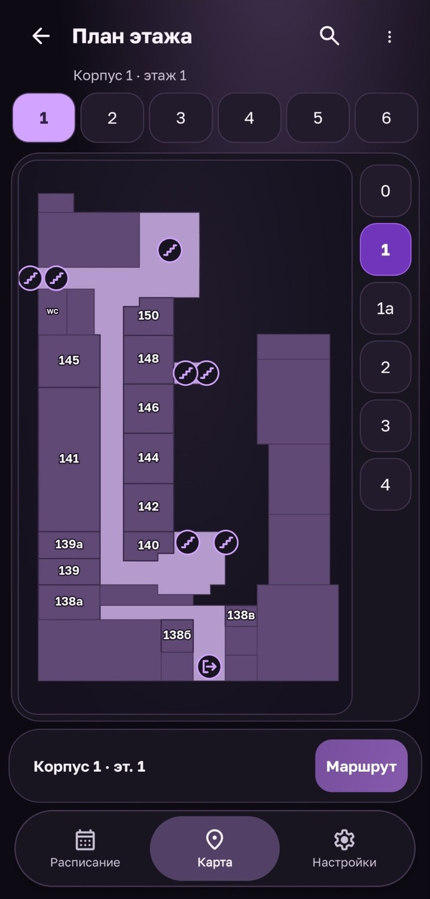
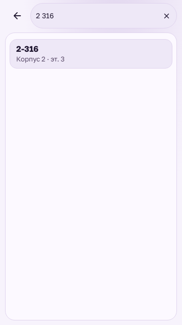
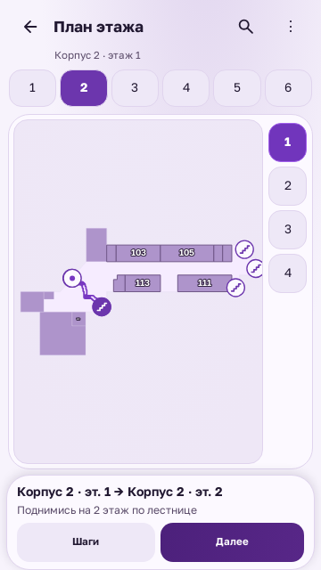

# Расписание УлГТУ

Учебный проект «Интерактивная карта аудиторий и навигация по корпусам УлГТУ». В Android-приложении «Расписание УлГТУ» для этого есть раздел «Карта». Он помогает найти корпус, открыть этаж, найти аудиторию и построить маршрут по доступным проходам. Расписание подсказывает номер кабинета.

[Презентация проекта](docs/Navigator-UlGTU.pptx) 

## Скриншоты

| Карта корпусов | План этажа | Поиск аудитории | Шаг маршрута |
| :---: | :---: | :---: | :---: |
|  |  |  |  |

Карта и план сняты на Android. Поиск и шаг маршрута показаны на снимках браузерной проверки интерфейса 0.10.3.

## Функционал

- Выбор группы и подгруппы, расписание по дням, текущая и следующая пара.
- Вход в личный кабинет УлГТУ и автоматический повторный вход при включённой настройке.
- Разбор файлов замен с Яндекс Диска и показ изменений для выбранной группы.
- Напоминания о занятиях, уведомления о заменах и кэш ранее загруженных данных.
- Поиск аудиторий, планы корпусов 1–6 и маршруты по имеющимся данным. Для пешего маршрута по городу требуется сеть.
- Светлая и тёмная темы.

Источники данных и уведомления о сторонних компонентах приведены в [THIRD-PARTY-LICENSES.md](THIRD-PARTY-LICENSES.md).

## Стек технологий

- Java, Android SDK, AndroidX WorkManager.
- HTML, CSS, JavaScript и SVG для картографических экранов на WebView.
- Jsoup для HTML, JSON для кэша расписания, SharedPreferences для настроек.
- osmdroid, Leaflet, OpenStreetMap и пешеходная маршрутизация OSRM/FOSSGIS.
- Gradle 8.9, Android Gradle Plugin 8.7.3 и JDK 17.

## Сборка и запуск

Нужны JDK 17, Gradle 8.9, Android SDK Platform 35, Build Tools 35.0.0 и Platform Tools. Для запуска нужен Android 8.0 (API 26) или новее. В Android Studio можно открыть каталог проекта и запустить модуль `app`.

```bash
git clone https://github.com/Ne1es/raspisanie-ulgtu.git
cd raspisanie-ulgtu
gradle :app:assembleDebug
adb install -r app/build/outputs/apk/debug/app-debug.apk
```

На Linux и macOS команда `./build-local.sh` также собирает APK и копирует его в `build/Timetable-0.10.4.apk`. При необходимости укажи путь к SDK через `ANDROID_HOME`.

Локальная сборка использует стандартный отладочный ключ Android. Для обновления уже установленной сборки с другим сертификатом используй подписанный APK из раздела ниже.

## Локальные тесты

Для проверок парсера, кэша и карты нужны JDK, Node.js, npm и JAR библиотеки `org.json:json`.

```bash
npm ci --prefix tests
JSON_JAR=/путь/к/json.jar ./test-local.sh
```

## Скачать APK

[Скачать подписанный APK 0.10.4](https://github.com/Ne1es/raspisanie-ulgtu/raw/refs/heads/main/apk/Timetable-UlSTU-0.10.4.apk) · [Изменения в версии 0.10.4](docs/RELEASE-v0.10.4.md)

```text
SHA-256: cda86aa438a9aec5fe2caf6d152a8d31018dfb6b6d883ea3141d6736885ccd95
```

## Контакты

Автор проекта - [Ne1es](https://github.com/Ne1es). Ошибки и предложения можно оставлять в [Issues](https://github.com/Ne1es/raspisanie-ulgtu/issues).

## Данные и права

В проект входят планы из официального навигатора УлГТУ. В материалах проекта не указано разрешение на их публичное распространение. Перед открытой публикацией исходников и APK уточни условия использования этих данных.
